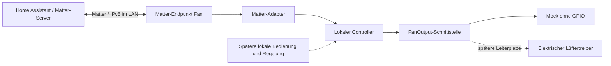

# Architektur

## Entscheidung

Primärer Build ist jetzt nativ unter Windows: Arduino-ESP32 mit vorgebautem Matter-Stack, Einstieg unter `firmware/windows/ventilation_controller`. Die portable Stufenlogik bleibt gemeinsam. WLAN-Zugangsdaten werden über USB eingerichtet; Matter koppelt anschließend im vorhandenen LAN. Der direkte ESP-IDF-/ESP-Matter-Einstieg unter `main/` bleibt als alternative Linux-Variante erhalten. Details: [Windows](windows.md).

ESP-IDF + ESP-Matter; zunächst Matter über WLAN. Der vorhandene Chip wurde auf COM5 als ESP32-D0WD-V3 (Revision v3.1) mit 4 MiB Flash identifiziert. IDF-Target: `esp32`. Der CP2102 stellt den USB-UART-Zugang bereit.

## Vorhandener Code

- `firmware/windows/ventilation_controller`: nativer Windows-Einstieg mit USB-WLAN-Einrichtung, NVS, MatterFan und einer Queue zwischen Matter-Callbacks und Controller. Zustandsmeldungen laufen auf dem Matter-Thread.
- `main/app_main.cpp` und `main/matter_adapter.cpp`: alternative direkte ESP-IDF-Implementierung. Endpoint-IDs werden vom SDK vergeben.
- `components/ventilation/include/ventilation.hpp`: hardwareunabhängige Stufen und Ausgabeschnittstelle.
- `MockFanOutput`: simulierte Ausgabe. Kein Anschluss, Pin, PWM-Signal oder Drehrichtungswechsel.
- Hosttests: Grenzwerte, alle Prozentwerte, ungültige Eingaben, Verhalten bei abgelehntem Ausgang.

Ein aggregierter Fan-Endpunkt steuert die gemeinsame Stufe aller vier Räume. Es gibt Aus/Leicht/Mittel/Stark mit 0/33/66/100 Prozent. FanMode bietet passend Off/Low/Medium/High; MultiSpeed meldet drei aktive Stufen. Drei zusätzliche Mode-Select-Endpunkte liefern die exakten deutschen Stufennamen, Durchzug/Wechsellüftung und die sechs gültigen Standard-Zuluftraum-Kombinationen. Endpoint 1 bleibt der bisherige Ventilator. Kein Auto-Feature, solange Sensorik und Regelung fehlen.

Die Anlage hat laut Nutzer vier Lüfter mit noch unbekannten Modellen. Geplant sind zwei Lüfterpaare hinter einem gemeinsamen Matter-Endpunkt. Welche Lüfter jeweils ein Paar bilden, ist noch offen. Home Assistant läuft als Container auf einem Raspberry Pi. Die Home-Assistant-Einrichtung bleibt auf Nutzerwunsch zunächst außen vor; Ziel ist die Ausgabe der Matter-Kopplungsdaten durch die laufende Firmware.

PercentCurrent ist in diesem Entwicklungsstand ausdrücklich simuliert, keine Drehzahlmessung. Der Adapter setzt Requests asynchron um; bei Fehlern ist die Protokollierung vorhanden. Retry, Fehlerdiagnose-Attribute und Wiederabgleich bei realen Treiberfehlern sind vor Einbau zu ergänzen.

## Späterer Funktionsumfang

Die VC40-H-Anleitung dient als Anforderungsquelle, nicht als vollständige Signalspezifikation. Implementiert sind Durchzug mit festen Richtungen und Wechsellüftung mit gemeinsamer Umkehr aller vier Räume. Die Simulationsintervalle 70/60/50 Sekunden sind eigene Werte innerhalb des dokumentierten Bereichs. Einschlafpause, Feuchteautomatik, Filterwartung und reale elektrische Kennlinien bleiben offen. Details: [Betriebsarten](control-modes.md).

Der Arduino-Loop führt Controller und Zeitsteuerung aus. Matter sendet typisierte Anforderungen über eine Queue; Rückmeldungen werden wieder auf dem CHIP-Thread veröffentlicht. Standardzuordnung und Betriebsart werden zusammen in einem versionierten NVS-Wert gespeichert. Die Zeitsteuerung berücksichtigt den millis()-Überlauf und arbeitet ohne Netzwerk weiter. Feuchteschutz und Verhalten bei Sensor-, Treiber- oder Spannungsausfall müssen vor dem realen Betrieb festgelegt werden.

Konfiguration und Matter-Fabric werden getrennt behandelt. Häufige Sollwertänderungen werden nicht bei jeder Änderung in Flash geschrieben. Aktuell startet der Mock immer mit Aus; produktiver Wiederanlauf ist noch offen. NVS-Fehler löschen niemals automatisch Netzwerkschlüssel oder Kopplungen.

## Reihenfolge

1. Erledigt: CP210x-Treiber, COM5 und ROM-Chip-/Flash-Erkennung (ESP32, 4 MiB).
2. Native Windows-Toolchain mit `scripts/setup-windows.ps1` einrichten.
3. Mit `scripts/build-windows.ps1` kompilieren und Speicherbedarf prüfen.
4. Erledigt: Flash-Sicherung, Mock-Firmware auf COM5 und WLAN über USB; Boot und Neustart mit persistenten Setup-Daten geprüft.
5. In Home Assistant koppeln; Stufen, Rückmeldungen, Neustart und WLAN-Wiederverbindung testen.
6. Hardwareprotokoll messen, Leiterplatte spezifizieren und echten Treiber ergänzen.
7. Betriebsarten, Sensorik, lokale Bedienung, Fehlerbehandlung und Updateweg ergänzen.

## Quellen

- [ESP-Matter Basis und SDK-Version](https://github.com/espressif/esp-matter/blob/4957e8331fbbed67d7b52010458fa59eab82a921/README.md)
- [Offizielle Entwicklungsumgebung](https://docs.espressif.com/projects/esp-matter/en/latest/esp32/developing.html)
