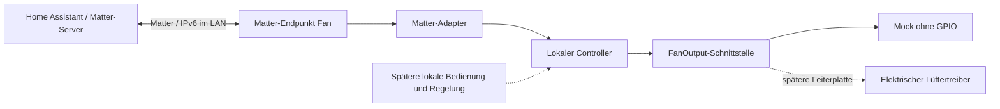

# Architektur

## Entscheidung

ESP-IDF + ESP-Matter; zunächst Matter über WLAN. Der vorhandene Chip wurde auf COM5 als ESP32-D0WD-V3 (Revision v3.1) mit 4 MiB Flash identifiziert. IDF-Target: `esp32`. Der CP2102 stellt den USB-UART-Zugang bereit.

## Vorhandener Code

- `main/app_main.cpp`: NVS und Matter starten, Netzwerkereignisse protokollieren, serielle Diagnose aktivieren.
- `main/matter_adapter.cpp`: FanControl-Anfragen prüfen, auf dem Matter-Thread anwenden, Zustand zurückmelden. Endpoint-ID wird vom SDK vergeben.
- `components/ventilation/include/ventilation.hpp`: hardwareunabhängige Stufen und Ausgabeschnittstelle.
- `MockFanOutput`: simulierte Ausgabe. Kein Anschluss, Pin, PWM-Signal oder Drehrichtungswechsel.
- Hosttests: Grenzwerte, alle Prozentwerte, ungültige Eingaben, Verhalten bei abgelehntem Ausgang.

Ein aggregierter Fan-Endpunkt reicht zunächst für eine gemeinsam gesteuerte Anlage. Vier logische Stufen werden über PercentSetting gewählt. FanMode bietet Off/Low/Medium/High; das entspricht hier 0/1/2/4. Stufe 3 ist über Prozentwerte erreichbar. Kein Auto-Feature, solange Sensorik und Regelung fehlen.

Die Anlage hat laut Nutzer vier Lüfter mit noch unbekannten Modellen. Geplant sind zwei Lüfterpaare hinter einem gemeinsamen Matter-Endpunkt. Welche Lüfter jeweils ein Paar bilden, ist noch offen. Home Assistant läuft als Container auf einem Raspberry Pi. Die Home-Assistant-Einrichtung bleibt auf Nutzerwunsch zunächst außen vor; Ziel ist die Ausgabe der Matter-Kopplungsdaten durch die laufende Firmware.

PercentCurrent ist in diesem Entwicklungsstand ausdrücklich simuliert, keine Drehzahlmessung. Der Adapter setzt Requests asynchron um; bei Fehlern ist die Protokollierung vorhanden. Retry, Fehlerdiagnose-Attribute und Wiederabgleich bei realen Treiberfehlern sind vor Einbau zu ergänzen.

## Späterer Funktionsumfang

Die VC40-H-Anleitung dient als Anforderungsquelle, nicht als vollständige Signalspezifikation. Geplant: Eco mit gegensinnigem Paarbetrieb, Durchlüften, zeitlich begrenztes Einschlafen, Feuchteautomatik und Filterwartung. Intervallwerte und Kennlinien werden erst nach Verifikation übernommen.

Lokale Regelung erhält später einen eigenen seriellen Ausführungskontext mit monotonen Timern. Matter, Taster und Sensorik senden Anforderungen an diesen Kontext. Netzwerkausfall darf lokale Schutz- und Regelungsfunktionen nicht stoppen. Feuchteschutz und Verhalten bei Sensor-, Treiber- oder Spannungsausfall müssen vor dem realen Betrieb festgelegt werden.

Konfiguration und Matter-Fabric werden getrennt behandelt. Häufige Sollwertänderungen werden nicht bei jeder Änderung in Flash geschrieben. Aktuell startet der Mock immer mit Aus; produktiver Wiederanlauf ist noch offen. NVS-Fehler löschen niemals automatisch Netzwerkschlüssel oder Kopplungen.

## Reihenfolge

1. Erledigt: CP210x-Treiber, COM5 und ROM-Chip-/Flash-Erkennung (ESP32, 4 MiB).
2. WSL2/Ubuntu und festgehaltene SDK-Kombination einrichten.
3. Firmware kompilieren, Speicherbedarf gegen erkannte Flashgröße prüfen.
4. Bestehenden Flash sichern; dann Mock-Firmware flashen.
5. In Home Assistant koppeln; Stufen, Rückmeldungen, Neustart und WLAN-Wiederverbindung testen.
6. Hardwareprotokoll messen, Leiterplatte spezifizieren und echten Treiber ergänzen.
7. Betriebsarten, Sensorik, lokale Bedienung, Fehlerbehandlung und Updateweg ergänzen.

## Quellen

- [ESP-Matter Basis und SDK-Version](https://github.com/espressif/esp-matter/blob/4957e8331fbbed67d7b52010458fa59eab82a921/README.md)
- [Offizielle Entwicklungsumgebung](https://docs.espressif.com/projects/esp-matter/en/latest/esp32/developing.html)
